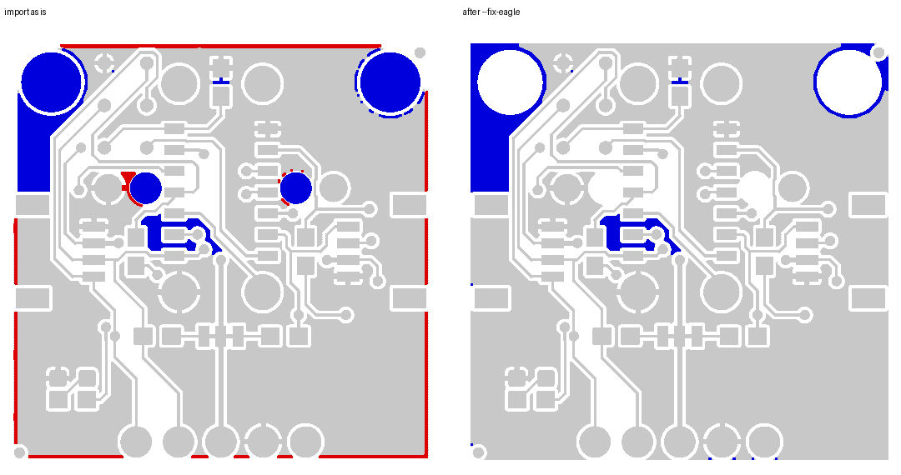

# Reviewing Altium / Eagle (and other) PCB designs in KiCad: how faithful is the import?

Clients send board files from Altium, Eagle, EasyEDA or Allegro. Before reviewing such a file in KiCad 10, I want
to know what the import keeps and what it silently changes. This repo measures that on two public boards, then (next
milestone) reviews each one the way a client would get it.

**Status:** milestone 1 (import fidelity) done; milestone 2 adds one sample review report per board
(`review/*/REVIEW.md`).

## The two sample boards

| | Altium | Eagle |
|---|---|---|
| Board | Bluetooth audio receiver (JieLi IC), 50 × 43 mm, 2 layers | SparkFun Qwiic Button, 25.4 × 25.4 mm, 2 layers, and its 3 × 3 production panel |
| Source | github.com/LZH-ang/Bluetooth-Audio-with-JieLi-IC, `PCB_Project/` | github.com/sparkfun/Qwiic_Button, `Hardware/`, `Production/` |
| License | GPL-3.0 (`samples/altium_blv/original/LICENSE`) | CC BY-SA 4.0 (`samples/eagle_qwiic_button/original/LICENSE.md`) |
| Design file | `BLV.PcbDoc` (native binary, OLE), `BLV.SchDoc` | `Qwiic_Button.brd` / `.sch` (Eagle 9.5.2 XML), `Qwiic_Button-Panel.brd` |
| Maker's Gerbers | `BLV.GTL/GBL/GTS/GBS/GTO/GBO/GKO`, NC drill, drill report | `Qwiic_Button-Panel.GTL/…/GKO`, Excellon `.TXT` |

The sample files are copied unchanged under `samples/*/original/`, with their licenses. Everything else in this
repo is my own work.

I chose a native binary PcbDoc on purpose. Many "Altium" files on GitHub are the ASCII variant exported by EasyEDA
(they start with `|RECORD=`), and those exercise a different reader.

## Method

1. **Import:** `kicad-cli pcb import --format altium|eagle` (KiCad 10.0.8), saved with its JSON import report
   (`samples/*/kicad/import_report*.json`).
2. **"Before" numbers from the original file, without KiCad** (`tools/source_metrics.py`).
   - PcbDoc: each `<Name>6/Header` stream holds the record count of `<Name>6/Data`. `Tracks6` is decoded record by
     record, with the layout from KiCad's `altium_parser_pcb.cpp`, so free copper tracks can be told apart from
     polygon and footprint primitives.
   - Eagle: the XML is read directly.
   - Rules: read from the PcbDoc `Rules6` stream and the Eagle `<designrules>`.
3. **"After" numbers from KiCad** (`tools/kicad_metrics.py`, pcbnew).
4. **Copper check against the maker's Gerbers** (`tools/reexport.py`, `tools/gerber_xor.py`).
   - The design is loaded through KiCad's importer, zones are refilled, and Gerbers and drill files are written.
   - Each layer is then drawn by gerbonara (an independent Gerber reader), rasterised at 0.05 mm/pixel and XORed
     against the maker's Gerber.
   - The two sets are registered on the top copper by phase correlation, because they do not share an origin and
     their outline layers differ.
   - Differences thinner than about 0.15 mm (3 pixels) are treated as rasterisation noise.
   - Tool check: the same file against itself gives 0.000 mm². F.Cu against B.Cu of one board gives 52 / 194 mm².

## Fidelity: Altium `BLV.PcbDoc`

| Item | Original (PcbDoc) | After KiCad import | Verdict |
|---|---|---|---|
| Components / footprints | 33 | 36 | The 3 extras are the free pads of the three 3.048 mm holes, wrapped in unnamed footprints |
| Nets | 31 | 31 | same |
| Pads | 109 | 110 (97 SMD, 13 PTH) | +1 is the printed antenna of A3: copper inside the footprint that carries a net, which KiCad can only keep as a pad, so it becomes a 17.5 × 6.35 mm custom-shape pad next to the real feed pad |
| Vias | 102 | 102 | same |
| Free copper tracks (straight, `Tracks6`) | 81 | 81 | same |
| Free copper arcs (`Arcs6`) | 51 | 50 | the missing arc is 0.0002 mm long (a 0.012° sweep at net 25); KiCad drops it as degenerate |
| Straight track length, top / bottom | 118.99 / 59.56 mm | 118.99 / 59.56 mm | identical to 0.01 mm |
| Arc length, top / bottom | 48.78 / 10.50 mm | 48.78 / 10.50 mm | identical |
| **All free copper (tracks + arcs), top / bottom** | **167.77 / 70.06 mm** | **167.77 / 70.06 mm** | identical |
| Polygons | 6 | 6 zones | same; each keeps its 10 mil gap |
| Keep-out tracks | 3 | 3 rule areas | kept as keep-outs |
| Drill hits | 115 (BLV.DRR) | 115 | same |
| Clearance rule | 10 mil | 0.2 mm default (7.9 mil) | **lost** |
| Track width rule | min 10 mil, preferred 12 mil | 0.2 mm default | **lost** |
| Hole-to-hole rule | 10 mil | not set | **lost** |
| Polygon connect (Rules6) | SMD pads and vias: Direct; TH pads: relief 12 mil | every pad: thermal relief 0.254 mm | **changed** |
| Solder mask expansion | 4 mil (BLV.RUL) | 0 | **lost** |

Copper XOR against the maker's Gerbers:

| Layer | Maker mm² | KiCad mm² | Only in maker's | Only in KiCad's | What it is |
|---|---|---|---|---|---|
| Top copper | 742.9 | 714.3 | 23.9 | 1.1 | rings around SMD GND pads and vias: Altium connects them Direct, KiCad refills with thermal reliefs |
| Bottom copper | 797.9 | 786.1 | 6.1 | 0.8 | same cause |
| Top mask | 222.2 | 175.6 | 18.8 | 0.3 | mask openings lack the 4 mil expansion |
| Bottom mask | 83.0 | 67.4 | 3.1 | 0.3 | same |
| Top / bottom silk | 128.2 / 24.3 | 117.6 / 19.8 | 19.6 / 9.1 | 3.6 / 3.1 | text drawn in a different font |

No track, pad or via copper is missing. Every copper difference is a polygon-to-pad connection (diff image
`results/xor_blv/diff_F_Cu.png`). Before signing off a review on the imported board, re-enter the clearance,
width, mask and polygon-connect rules by hand, or refill the zones with the original style. Otherwise a DRC in
KiCad checks against looser rules than the designer used.

## Fidelity: Eagle `Qwiic_Button.brd` (and the production panel)

| Item | Original (.brd XML) | After KiCad import | Verdict |
|---|---|---|---|
| Elements / footprints | 48 | 48 (22 without pads: logos, frame, fiducial marks) | same |
| Signals / nets | 21 | 21 | same |
| Vias | 38 | 38 | same |
| Wires / tracks | 193 | 193 | same |
| Wire length, top / bottom | 214.12 / 79.95 mm | 214.12 / 79.95 mm | identical |
| Polygons | 2 | 2 zones | same |
| Copper clearance (mdWireWire) | 7 mil | min clearance 0.1778 mm (7 mil) | kept |
| Minimum width (msWidth) | 7 mil | min track 0.2 mm | **changed** (stricter than the design) |
| tRestrict / bRestrict arcs (STAND-OFF) | 8 | on an undefined layer | **lost**: no copper keep-out around the screw holes |
| Dimension lines + "Units in Inches" text | 3 | on an undefined layer | lost (documentation only) |
| Panel V-score lines and labels (`Qwiic_Button-Panel.GKO`) | present | not in Edge.Cuts | **lost**: the panel cannot be re-fabbed from the KiCad export |
| Drill hits, panel | 423 | 36 NPTH + 387 PTH = 423 | same |

Track length counts only routed copper ("free" primitives: not part of a footprint, a polygon or a keep-out). On
both boards it is the sum of straight segments and arcs, so the Altium straight-only row and the all-segments row
are both shown.

- **Practical catch:** the `.kicad_pcb` written by `kicad-cli pcb import` contains items on the UNDEFINED layer.
  KiCad then refuses to reopen that file ("One or more items were found on undefined layers"), both from
  `kicad-cli` and from the pcbnew API.
  - In the GUI, the importer asks for a layer mapping, so mapping Eagle layers 41/42 to a rule area or a user layer
    there avoids the problem.
  - The scripts here load the `.brd` through KiCad's Eagle plugin in memory and move those items to Cmts.User
    (11 on the single board, 88 on the panel), listing them.

Copper XOR, production panel (3 × 3):

| Layer | Maker mm² | KiCad mm² | Only in maker's | Only in KiCad's | What it is |
|---|---|---|---|---|---|
| Top copper | 3794.0 | 4060.3 | 137.0 | 388.1 | Eagle `<hole>`s become NPTH pads larger than the drill (3.302 mm stand-off holes as 3.607 mm pads, the 1.6 mm pegs of the 12 mm switch as 1.905 mm pads) and KiCad plots their copper; the pour also runs into the STAND-OFF restrict circles; the red frame is the pour pulled back 0.5 mm from the edge instead of 7 mil |
| Bottom copper | 4446.7 | 4488.4 | 220.0 | 255.4 | same causes |
| Top / bottom mask | 1232.8 / 700.2 | 1246.6 / 716.2 | 0.0 / 0.0 | 0.0 / 0.0 | match |
| Top / bottom silk | 415.2 / 814.9 | 457.8 / 828.1 | 0.0 / 0.0 | 4.0 / 2.0 | match, KiCad strokes slightly wider |
| Outline | 632.8 | 326.3 | 299.6 | 0 | V-score lines and labels missing |

Most of the NPTH copper is drilled away, but a ring of 0.15 mm stays around each hole, and a fab's CAM check may
flag copper on an unplated hole. The restrict loss matters: the pour runs under the screw heads of the stand-offs.

### The corrected Eagle board

`tools/reexport.py --fix-eagle` loads the `.brd` the same way and then puts back, by hand, what the import lost:

1. a copper keep-out disc (fills, tracks, vias; both layers) of radius 1.956 mm on every STAND-OFF, which is the
   outer edge of Eagle's 0.2032 mm restrict ring at r = 1.854 mm;
2. NPTH pads without copper (the mask openings are kept);
3. copper-to-edge 7 mil (Eagle `mdCopperDimension`; the import left KiCad's 0.5 mm);
4. on the panel, the 8 V-score lines moved to `User.1` with a keep-out strip of the same 7 mil pull-back. This made
   no measurable copper difference, because the lines run in the gaps between boards.

The corrected boards open in KiCad (the script reloads each one before writing fab files):
`samples/eagle_qwiic_button/kicad/fixed/Qwiic_Button_fixed.kicad_pcb` and
`samples/eagle_qwiic_button/kicad/fixed_panel/Qwiic_Button-Panel_fixed.kicad_pcb`.

XOR of the corrected panel against the maker's Gerbers (`results/xor_qwiic_panel_fixed/`):

| Layer | Only in maker's, import as is → corrected | Only in KiCad's, import as is → corrected |
|---|---|---|
| Top copper | 137.0 → **0.0** mm² | 388.1 → 247.5 mm² |
| Bottom copper | 220.0 → 10.2 mm² | 255.4 → 162.7 mm² |
| Masks, silk | unchanged (match) | unchanged |

The stand-off discs, the NPTH rings and the edge frame are gone. What KiCad still pours and Eagle did not is the
same three spots on each of the nine boards: the corner between the H2 hole and the left edge, a small island
inside a track loop between S1 and U4, and a thin ring just outside the H1 keep-out. All three are GND pour that Eagle's
fill engine left out and KiCad's keeps, which points at the two engines treating isolated or narrow regions
differently (Eagle removes unconnected polygon parts, "orphans"). I tried raising KiCad's minimum fill width to
Eagle's 0.2032 mm polygon width: the difference grew (top copper only-KiCad 446 mm²), so that is not the cause, and
the rest is left as an unexplained pour difference. The panel outline difference stays: V-score is not a cut, so
it is not put on Edge.Cuts.

## What to ask a client for

| Tool | Send | Why |
|---|---|---|
| Altium Designer | `.PcbDoc` + `.SchDoc` + `.PrjPcb`, **and** the Gerber/NC drill set and `*.RUL` / design-rule report of the same revision | geometry imports cleanly, rules do not (see above); the rule report and Gerbers are the reference |
| Eagle / Fusion Electronics | `.brd` + `.sch` (XML, Eagle 6+), the `.dru` rules file, and the CAM output | restrict layers and panel milling/V-score layers need checking against the CAM output |
| EasyEDA / EasyEDA Pro | the project export (JSON / `.epro`) plus Gerbers | KiCad 10 has EasyEDA and EasyEDA Pro importers (in pcbnew's plugin list); not measured here yet |
| Cadence Allegro | the `.brd`, or better a FabMaster extract, ODB++ or IPC-2581, plus Gerbers | KiCad 10 lists Allegro, FabMaster, ODB++ and IPC-2581 importers; no openly licensed Allegro sample was found for this study |
| Any tool | Gerbers + drill of the exact revision | the only ground truth that does not depend on any importer |

## Files

| Path | What |
|---|---|
| `samples/*/original/` | the public design files and the maker's Gerbers, unchanged, with their licenses |
| `samples/*/kicad/` | KiCad import (`.kicad_pcb`), import report, re-exported Gerbers; `fixed*/` the corrected Eagle boards |
| `review/*/REVIEW.md` | the two sample review reports, with crop images in `img/` and the DRC JSON they are based on |
| `results/*_source.json`, `results/*_kicad.json` | counts before / after |
| `results/xor_*/` | per-layer XOR report and diff images (red = only in the maker's Gerber, blue = only in KiCad's) |
| `tools/` | the scripts above; `gerber_xor.py` needs gerbonara (path in `GERBONARA_PY`) and CairoSVG; `review_board.py` restores the original rules and runs DRC; `crops.py` renders the report images |

## License

- The sample designs and the maker's Gerbers under `samples/*/original/` keep their own licenses: GPL-3.0 for the
  Altium board (`samples/altium_blv/original/LICENSE`), CC BY-SA 4.0 for the SparkFun board
  (`samples/eagle_qwiic_button/original/LICENSE.md`).
- Files derived from a sample keep that sample's license: the KiCad imports and corrected boards, re-exported
  Gerbers, diff images and the review report with its images under `review/<sample>/`.
- My own scripts in `tools/` and the text of this README are MIT licensed (`LICENSE`).

## Not checked yet

- Schematic import: `kicad-cli` only imports boards; schematics go through the KiCad GUI importers.
- Allegro and EasyEDA samples.
