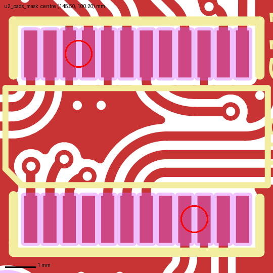
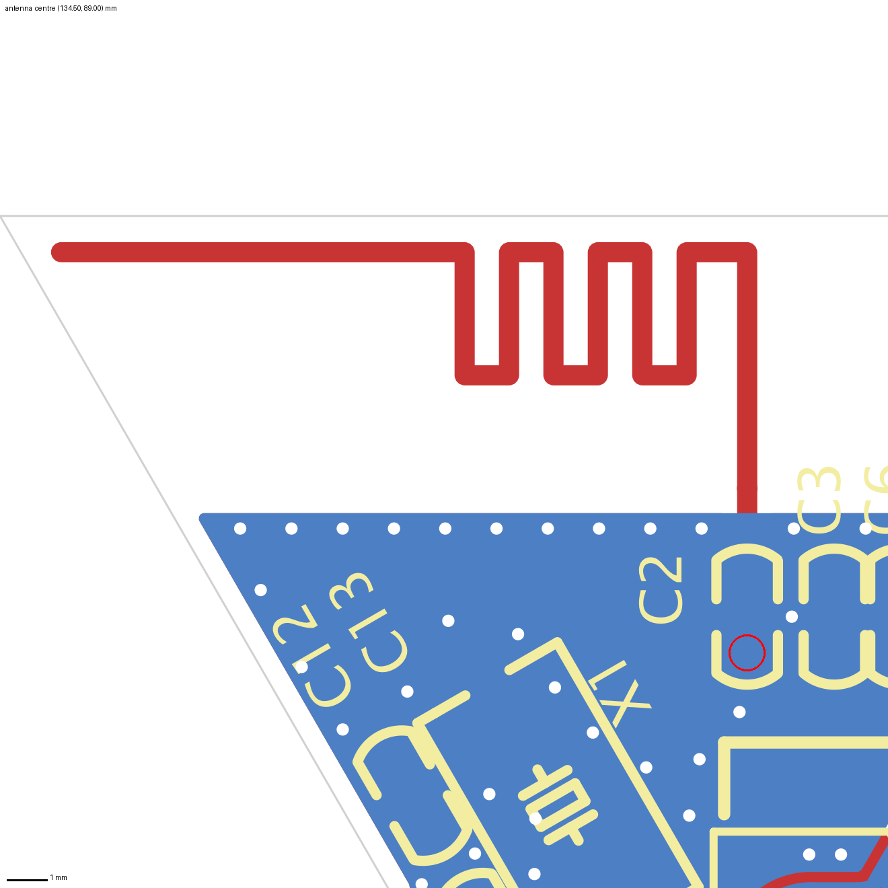
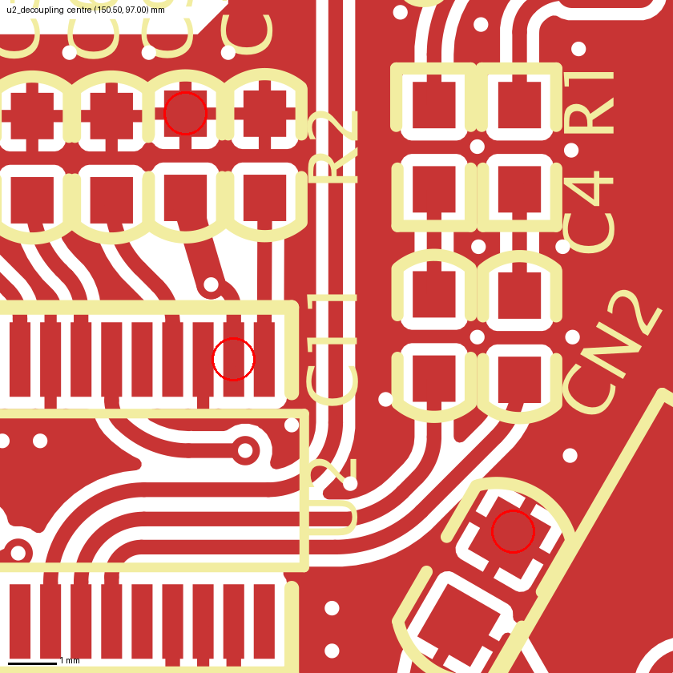
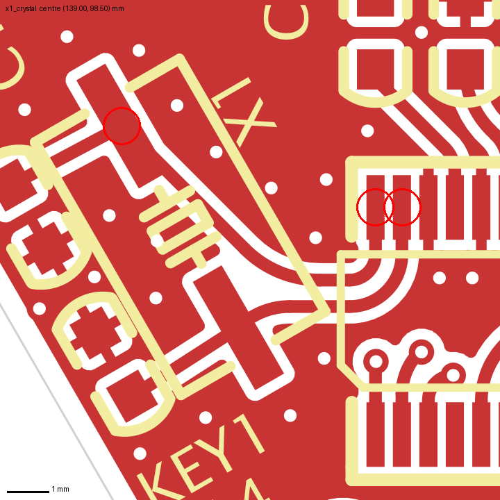
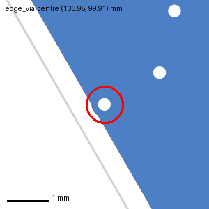
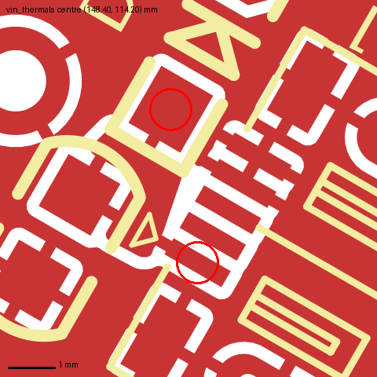

# Design review: Bluetooth audio receiver (`BLV.PcbDoc`, Altium)

Sample report. The board is a public GPL-3.0 design (see the repo README); it is reviewed here the way a client's
Altium file would be: imported into KiCad 10.0.8, the designer's own rules put back, then checked by DRC and by eye.

- Board: triangular (equilateral, 50 mm sides, 43.3 mm high), 2 layers, 33 parts, 31 nets. JieLi Bluetooth audio IC (U2, QSOP-24), printed 2.4 GHz
  antenna (A3), micro-USB power in, two XH 2.54 connectors (CN1 speaker, CN2 battery), RGB LED, one key.
- Files used: `BLV.PcbDoc`, and the maker's Gerbers and `BLV.RUL` of the same revision as reference.
- **Rules checked against** (from the PcbDoc and `BLV.RUL`, not KiCad defaults): clearance 10 mil, track width min
  10 mil, hole-to-hole 10 mil, solder mask expansion 4 mil (in `BLV.RUL` and the maker's mask Gerber; the PcbDoc
  rule itself is disabled).
- **Coordinates** are in mm as KiCad shows the imported board (Altium's own origin is not kept). Each finding also
  names the part and pad, which do not depend on the origin.

## Findings at a glance

| Severity | Count | Findings |
|---|---|---|
| Critical | 0 | none found |
| Should fix | 2 | no solder mask dams on U2; no antenna matching footprint |
| Note | 6 | U2 3.3 V decoupling; crystal placement; via near edge; silk over edge; tiny dangling arcs; +/- on the bottom silk |

KiCad's DRC reported 50 errors and 119 warnings. 22 of the errors are finding 1; 27 come from the import, not
from the design (see "What DRC reported and why"). No unconnected items and no shorts.

## Should fix

### 1. U2: no solder mask between the pins

- Where: U2 (QSOP-24, 0.635 mm pitch), centre (145.50, 100.20); both rows, e.g. pads 9–10 at (147.41, 102.93) and
  pads 20–21 at (144.24, 97.48).
- What: the pads are 0.435 mm wide with 0.199–0.201 mm between them. The maker's mask Gerber `BLV.GTS` opens each
  pad 4 mil (0.102 mm) larger on every side, so each opening is 0.638 mm wide at a 0.635 mm pitch: the openings
  touch, and each row becomes one gang opening with no mask dam between pins.
- Why it matters: without dams, solder can wick between 0.635 mm pitch pins during reflow. Gang openings are
  common at this pitch and many assemblers accept them. Nothing in the file shows it was decided: the PcbDoc's
  `MinimumSolderMaskSliver` rule (10 mil), the check that would have reported the missing dams, is disabled.
- Fix: set the mask expansion of U2's pads to 0.05 mm or less, which leaves a dam of about 0.1 mm. Check the fab's
  minimum dam width (often 0.1 mm for green mask).

### 2. Antenna feed has no footprint for a matching network

- Where: A3 printed antenna, top left; fed from U2 pin 21 through C2 (10 pF, marked) at (142.01, 94.17).
- What: the only part between the RF pin and the antenna is the series capacitor C2. There is no pad for a
  shunt element on either side.
- Why it matters: a printed antenna's match moves with board thickness, enclosure and nearby parts. Without a
  π network footprint (populated with 0 Ω / not fitted by default), the only way to re-tune it is a new board.
- Fix: add a π network (two shunt pads to ground around C2). Keep the rest as is: the antenna area is clear of
  copper on both layers and the ground pour edge is stitched with vias, which is right.

## Notes

3. U2 has only a 10 µF capacitor near its 3.3 V pin. Pin 14 at (148.36, 97.48); C9 (10 µF) is about 2 mm away
   edge to edge with a 2.5 mm track, which is close enough. There is no small (100 nF or less) capacitor at the pin;
   the only 100 nF on 3.3 V, C14, is 7.3 mm away. Check the IC's reference layout; if it shows a small capacitor at
   this pin, add one. 
4. Crystal X1 (24 MHz) is 4.7–6.4 mm from U2's crystal pins 23/24 at (142.65, 97.48) and (142.01, 97.48); its
   load caps C12/C13 are 7.9 and 8.8 mm from those pins. Ground pour surrounds the traces, which
   helps. If the board is re-spun, move X1 and its caps closer to U2. 
5. GND via 0.46 mm from the board edge at (133.95, 99.91) (0.61 mm via, 0.30 mm drill). The design has no
   edge-clearance rule; KiCad's default 0.5 mm flags it. Most fabs accept ≥ 0.3 mm for a routed edge, so this is
   fine unless the board is V-scored. 
6. Silk crosses the board edge on USB1 and KEY1 (5 places), where the parts sit at the edge; the fab clips the
   silk.
7. Four tiny dangling arcs (0.03–0.41 mm) at pad entries of C1, LED1, C7 and C2, e.g. (142.54, 94.17). They
   are in the original file (Altium `Arcs6`), not created by the import. Harmless; delete them for a clean DRC.
8. "+" and "−" on the bottom silk are not mirrored (CN1, CN2). The glyphs are symmetric, so they read
   correctly from the back. One "+" overlaps pad 2 of CN2 and will be partly clipped by the fab.

## What DRC reported and why

| DRC item | Count | Verdict |
|---|---|---|
| Clearance, U2 pad to pad (0.199 mm < 10 mil) | 22 | import artifact. The Altium clearance rule has "ignore pad to pad clearances within a footprint" set (`IGNOREPADTOPADCLEARANCEINFOOTPRINT=TRUE` in the PcbDoc); the import drops that switch. With that switch, Altium's DRC does not check these pairs. In KiCad, add a custom rule with `A.Parent == B.Parent` |
| Solder mask bridge, U2 | 22 | real, finding 1 |
| Starved thermal: VIN on USB1 pad 1 and D1, 3.3 V on C8, GND on U2 pads 10 and 15 | 5 | import artifact. Altium connects SMD pads to the pour directly (rule `PolygonConnect`: SMD Direct); the importer gives every pad a thermal relief. The maker's Gerbers show direct connections. In KiCad set those zones' pad connection to Solid for SMD pads.  |
| Copper to edge | 1 | note 5 |
| Library footprint issues | 33 | import artifact: the footprints come from the PcbDoc's embedded library, which KiCad has no library for |
| Silk overlap 64, text thickness 8 | 72 | text converted to KiCad's stroke font; cosmetic |
| Silk to edge 5, dangling track 4, unmirrored back text 4, silk over copper 1 | 14 | notes 6–8 |

## Limits of reviewing from an import

- Rules are re-entered by hand. The import keeps none of the design rules (README, fidelity table). This review
  restored clearance, width, hole-to-hole and mask expansion, and then had to read the rule options in the PcbDoc
  to tell 22 false clearance errors from real ones. Altium rules that KiCad has no direct equivalent for
  (polygon connect per object type, plane clearance 20 mil, routing via limits 8–24 mil) were read but not enforced.
- Copper pours are refilled by KiCad, not taken from Altium. Pour shapes differ slightly from the maker's
  Gerbers (thermal reliefs; see the XOR in the README), so pour-related findings were checked against the Gerbers.
- One antenna pad is synthetic. The antenna copper became a custom-shape pad on import; it is the same copper,
  but a DRC on the antenna itself is not meaningful.
- Not checked: the schematic (only the PCB was imported), the BOM and part values against datasheets, the IC
  datasheet's own layout rules, board thickness and stack-up (so no RF trace impedance), antenna performance (needs
  a VNA or a field solver), enclosure and mechanical fit, assembly-house rules beyond the general ones above.
- What would make this review stronger: the schematic as PDF, the IC's hardware design guide, the stack-up the
  fab will build, and the Altium DRC report the designer saw.
