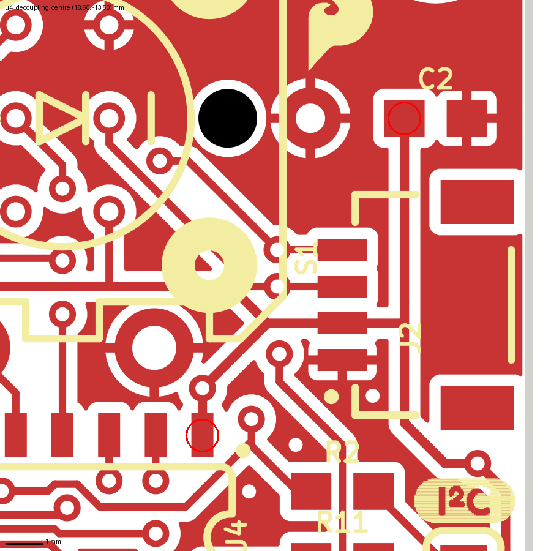
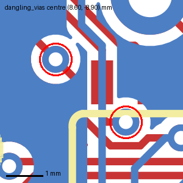
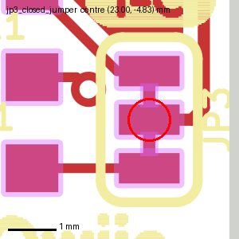
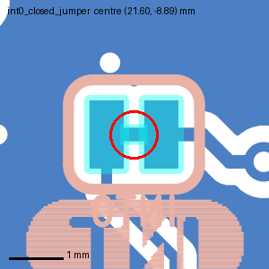
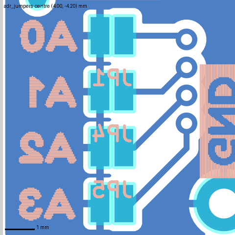
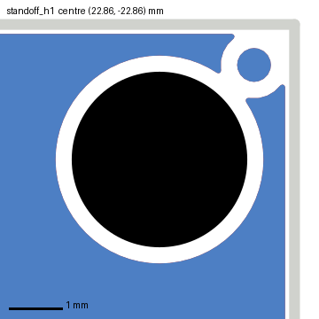

# Design review: Qwiic Button (`Qwiic_Button.brd`, Eagle 9.5)

Sample report. The board is SparkFun's public CC BY-SA 4.0 design (see the repo README). It is reviewed the way a
client's Eagle file would be: imported into KiCad 10.0.8, the import losses corrected
(`tools/reexport.py --fix-eagle`), the designer's rules put back, then checked by DRC and by eye.

- Board: 25.4 × 25.4 mm, 2 layers, 26 footprints with pads (48 elements in all, counting logos and fiducial marks), 21 Eagle signals. ATtiny84 (U4, SOIC-14) as an I²C target behind two
  Qwiic connectors (J2, J3), a 12 mm lit push button (S1), address and pull-up solder jumpers, two 3.3 mm stand-off
  holes (H1, H2).
- Files used: `Qwiic_Button.brd`, and the maker's production panel Gerbers as reference.
- Rules checked against (from the `.brd` `<designrules>`): copper clearance 7 mil, minimum width 7 mil, minimum
  drill 15 mil, copper to board edge 7 mil.
- Coordinates are in mm as KiCad shows the imported board: x to the right, y downwards, origin at the board's
  lower-left corner, so y runs from 0 to −25.4.

## Findings at a glance

| Severity | Count | Findings |
|---|---|---|
| Critical | 0 | none found |
| Should fix | 1 | the only decoupling capacitor is 10 mm from U4 |
| Note | 4 | two SDA/SCL vias connected on one layer only; small silk text; silk on pads of J1/J5; silk over the edge |

KiCad's DRC reported 26 errors and 177 warnings. All 26 errors are solder jumpers doing what they are designed to
do (see "What DRC reported and why"). No unconnected items.

## Should fix

### 1. U4: the only decoupling capacitor is 10 mm away

- Where: U4 pin 1 (VCC, 3.3 V) at (16.51, −9.15); C2 (100 nF, pad 1 at (22.01, −17.78)) is 10.2 mm away in a
  straight line, further along the track. C2 is the only capacitor on the board.
- Why it matters: the ATtiny84 switches its I/O, including the button LED, from this pin; 10 mm between the pin and
  its only capacitor makes local supply dips at each edge larger. The Qwiic cable adds more inductance upstream, so
  nothing else on the board covers for it.
- Fix: add a 100 nF 0402/0603 between pins 1 and 14 of U4 (VCC and GND face each other across the same end of the
  package, 5.6 mm apart), or move C2 there.

## Notes

2. Two vias are connected on one layer only: SDA at (9.54, −8.06) and SCL at (7.62, −9.78), both next to U4.
   Each is a stub that leads nowhere on the other layer. Harmless electrically, but usually a leftover of rerouting.
   Remove them, or confirm they are meant as probe points. 
3. Silk text is 0.51 mm high (22 texts, e.g. the reference of U4). Many fabs print down to 0.8 mm only; at 0.5 mm
   the text may come out unreadable. Check the fab's minimum or enlarge the important labels.
4. Silk on exposed copper: 116 places, mostly the edge pads of J1 (76) and J5 (25). Fabs clip silk off pads, so
   the board is fine, but those labels lose parts of their strokes.
5. Silk crosses the board edge for the references of H1, H2 and JP7 (3 places); the fab clips them.

## What DRC reported and why

| DRC item | Count | Verdict |
|---|---|---|
| Shorting items (7) and clearance (6) at JP3 (23.62, −4.83) and INT0 (21.59, −8.89) | 13 | intentional. Both jumpers are closed by a thin copper trace inside the footprint, to be cut by the user. Eagle draws that trace as footprint copper without a net, so KiCad sees a short between the pads. In KiCad, the proper model is a net-tie footprint.   |
| Solder mask bridge at JP1, JP4, JP5, JP7 (open jumpers) and JP3, INT0 | 13 | intentional: a solder jumper needs one mask opening across both pads so a solder blob can close it.  |
| Silk over copper 116, silk overlap 34, text height 22, silk to edge 3 | 175 | notes 3–5, and silk lines touching each other (cosmetic) |
| Via connected on one layer | 2 | note 2 |

## What the import changed, and what was corrected before reviewing

Reviewing the raw import would have produced one false "should fix" and hidden a real rule:

| Import loss | Effect on a review | Corrected here |
|---|---|---|
| tRestrict/bRestrict rings of the STAND-OFF holes put on an undefined layer | the ground pour runs under the screw heads at H1 and H2, which looks like a short risk to the chassis | yes: copper keep-out discs of r 1.956 mm restored  |
| Eagle holes imported as NPTH pads larger than the drill | copper rings around the stand-off holes and the switch pegs | yes: NPTH pads without copper |
| Copper-to-edge rule 7 mil not imported (KiCad default 0.5 mm) | every pour edge would be flagged | yes: 7 mil |
| Minimum width imported as 0.2 mm instead of 7 mil (0.178 mm) | stricter than the design | yes, in the review rules: 7 mil |
| Dimension lines and the "Units in Inches" text on an undefined layer | the saved `.kicad_pcb` does not open | yes: moved to Cmts.User |

After these corrections the panel's copper matches the maker's Gerbers except for three small GND pour areas per
board that KiCad fills and Eagle did not (README, "The corrected Eagle board"). None of the findings above is in
those areas.

## Limits of reviewing from an import

- The design was reviewed after hand corrections, which assume the restrict rings, holes and rules mean what they
  mean in Eagle. A client's own `.dru` file may differ from the rules saved in the `.brd`.
- Pour shapes are KiCad's, not Eagle's. Pour findings were checked against the maker's Gerbers.
- Not checked: the schematic (only the board was imported), part values and the BOM, the ATtiny84 firmware's use of
  the pins, the I²C pull-up values against bus length (2.2 kΩ, cuttable through JP3), the Qwiic connector pinout
  against the Qwiic standard, the panel (V-score lines and rails are not in KiCad's Edge.Cuts, see README), and the
  mechanical fit of the 12 mm button and stand-offs.
- What would make this review stronger: the schematic PDF, the `.dru` file actually used, and the CAM job, so that
  panel and milling layers can be checked against what the fab received.
